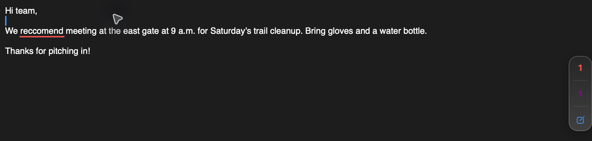
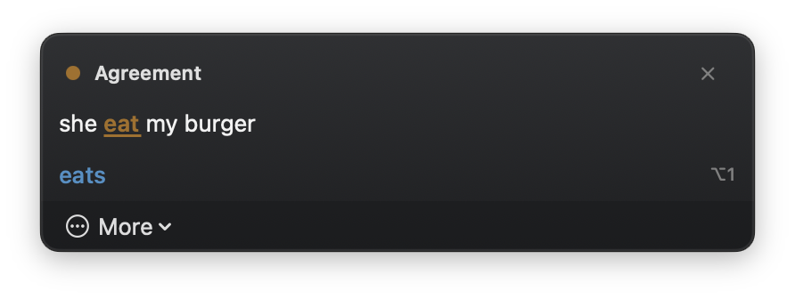
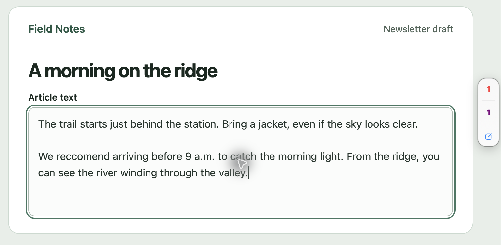
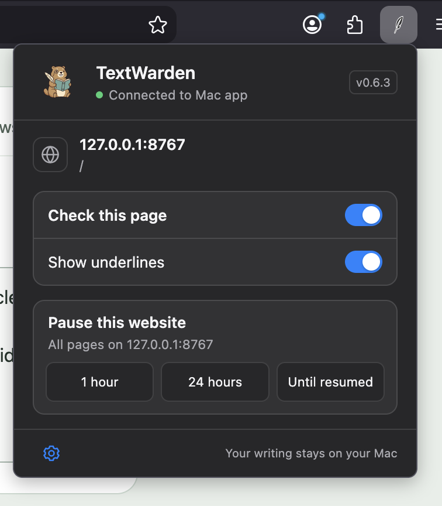
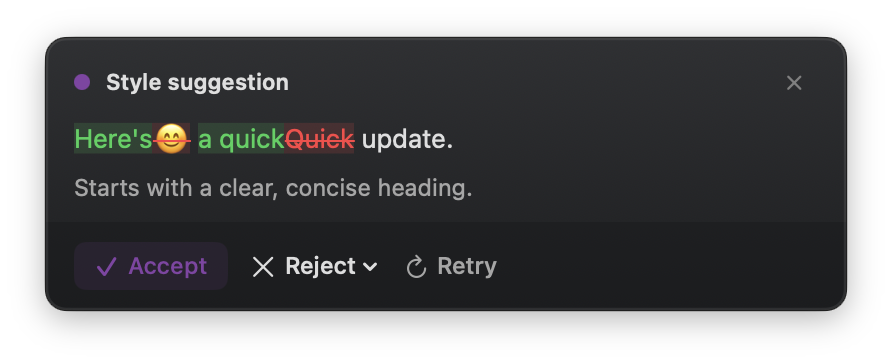
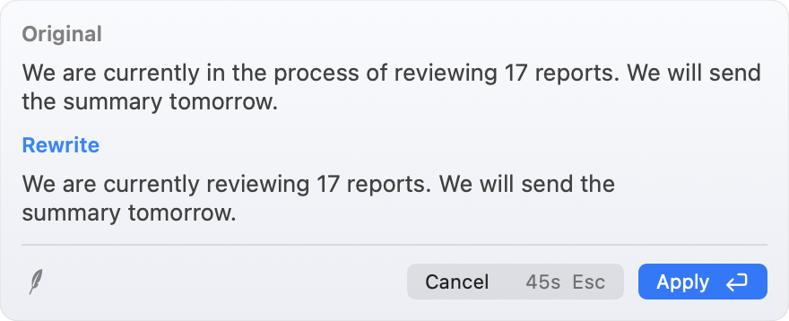
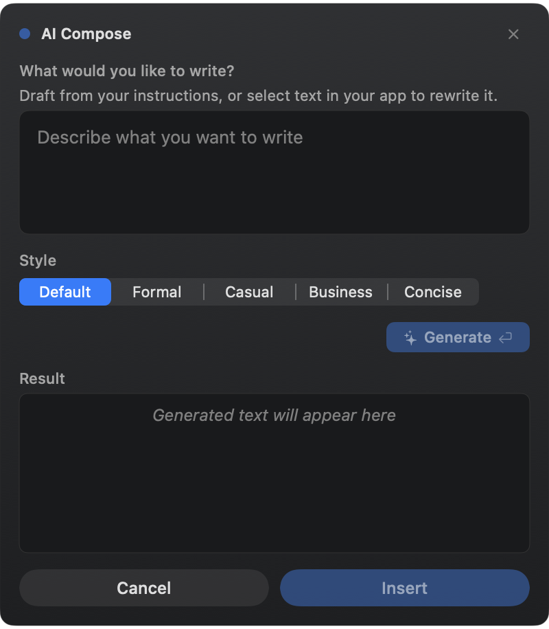

# TextWarden in action

These examples use fictional text.

## Checking an Apple Mail draft

TextWarden underlines a typo in the message body. The floating pill groups spelling and grammar findings, style suggestions, and AI Compose.

### Grammar suggestions in chat

TextWarden highlights the verb and offers a subject–verb agreement correction.

## Checking a web editor

The light-mode browser example shows the floating pill next to a newsletter draft.

### Browser extension controls

Open TextWarden from the Firefox toolbar to see its Mac app connection and control checking and underlines for the current page.

## Style suggestions

Review the proposed edit and the reason before accepting it. Style suggestions use Apple Intelligence on supported Macs.

## Quick Rewrite

Select text and compare the original with the proposed rewrite before applying it.

## AI Compose

Give TextWarden an instruction and choose the tone for a new draft or a rewrite of selected text.

[Back to the README](../README.md)
