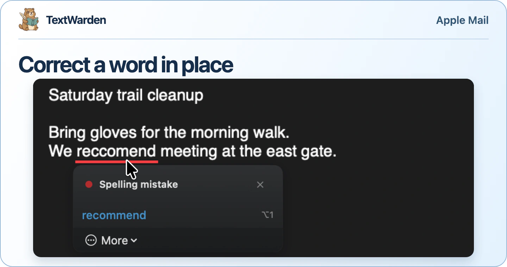
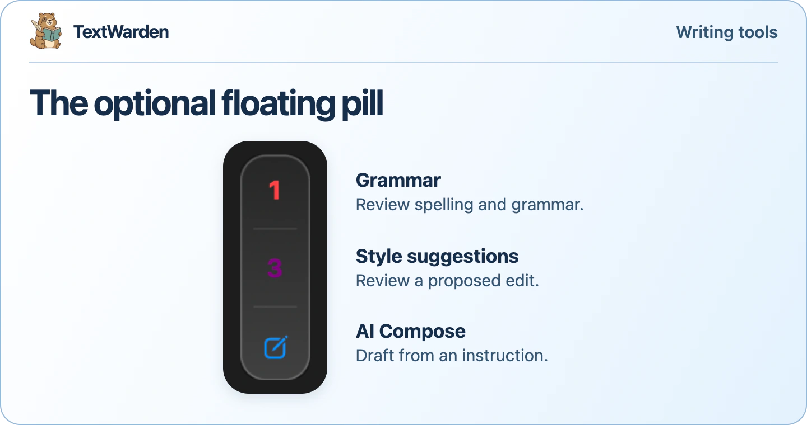
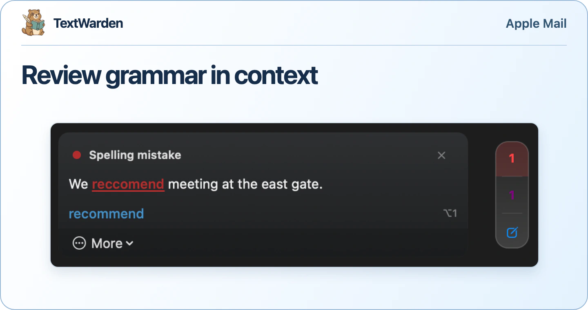
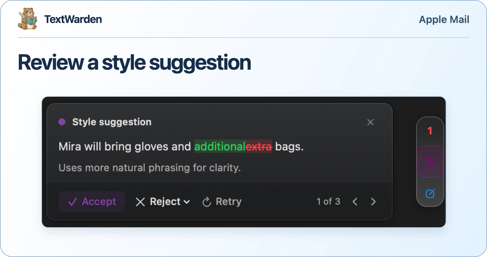
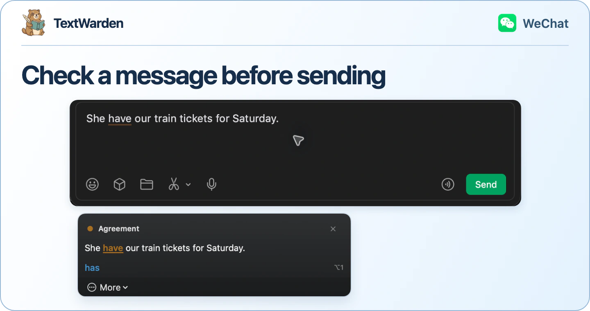
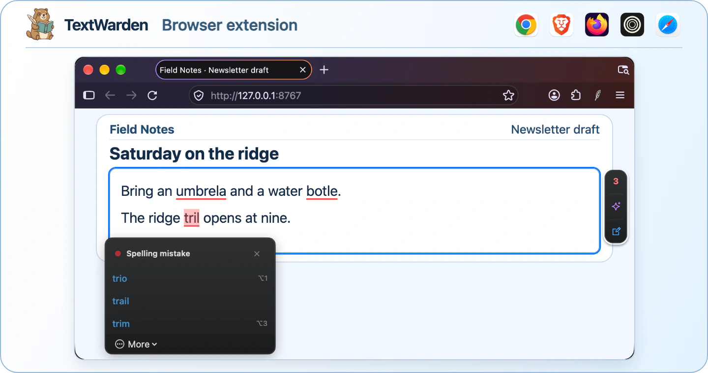
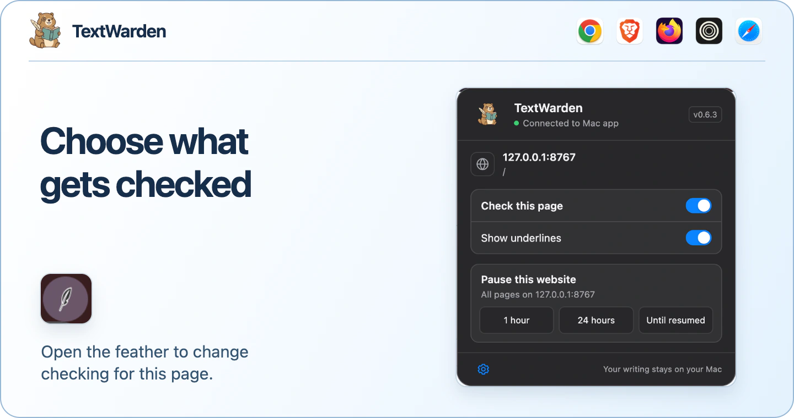
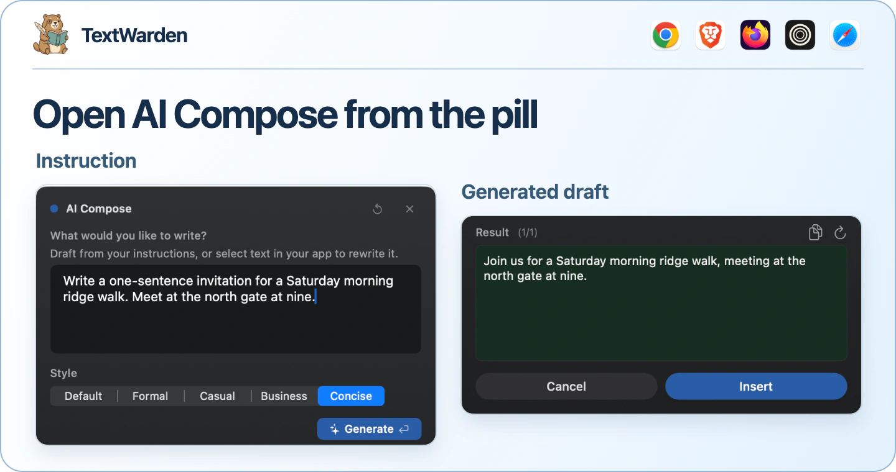
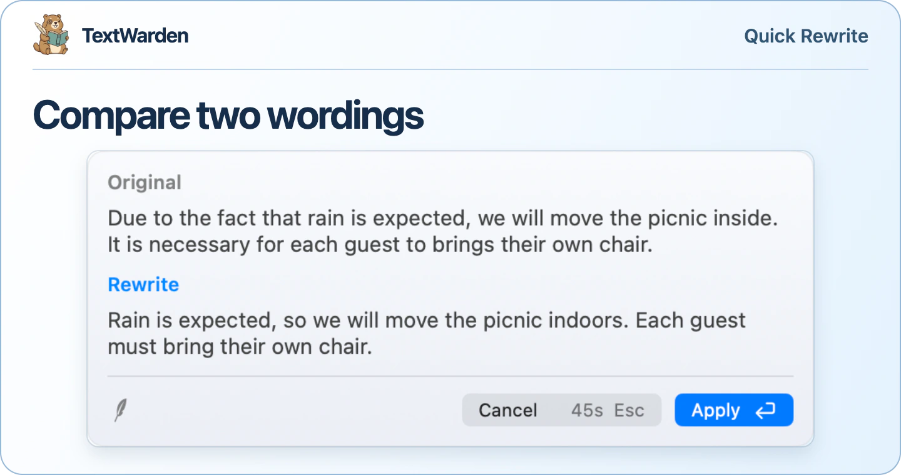
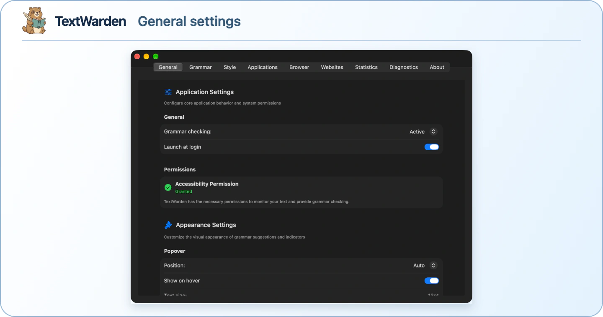

# TextWarden in action

Apple Mail, WeChat, and Firefox show how TextWarden works across a few of its [supported apps](../README.md#supported-apps). The drafts are fictional. Click any screenshot to see it at full size.

## Correct a word in place

The spelling popover opens on **reccomend**. Choose **recommend** to replace it in the draft.

  <a href="screenshots/mail-underline.webp">
    <picture>
      <source media="(max-width: 600px)" srcset="screenshots/mail-underline-mobile.webp">
      
    </picture>
  </a>

## The floating pill

The pill is optional. Its top control opens grammar, the middle opens style suggestions, and the pencil opens AI Compose.

  <a href="screenshots/floating-pill.webp">
    <picture>
      <source media="(max-width: 600px)" srcset="screenshots/floating-pill-mobile.webp">
      
    </picture>
  </a>

### Grammar in Mail

Hover over the red grammar count to see the mistake in its sentence.

  <a href="screenshots/mail-grammar.webp">
    <picture>
      <source media="(max-width: 600px)" srcset="screenshots/mail-grammar-mobile.webp">
      
    </picture>
  </a>

### Style in Mail

Open the purple count to see the proposed wording. Accept the edit, reject it, or ask for another suggestion.

  <a href="screenshots/mail-style.webp">
    <picture>
      <source media="(max-width: 600px)" srcset="screenshots/mail-style-mobile.webp">
      
    </picture>
  </a>

### Grammar in WeChat

While you’re writing a WeChat message about Saturday’s train tickets, TextWarden underlines **have** and suggests **has**. It also checks chat drafts in WhatsApp, Telegram, and Apple Messages.

  <a href="screenshots/wechat-agreement.webp">
    <picture>
      <source media="(max-width: 600px)" srcset="screenshots/wechat-agreement-mobile.webp">
      
    </picture>
  </a>

## Writing in Firefox

The newsletter has three spelling findings. For **tril**, TextWarden offers **trio**, **trail**, and **trim**. Here, **trail** fits the route description.

  <a href="screenshots/firefox-underline.webp">
    <picture>
      <source media="(max-width: 600px)" srcset="screenshots/firefox-underline-mobile.webp">
      
    </picture>
  </a>

### Extension controls

Open the toolbar feather to check the connection to the Mac app, toggle underlines, or pause checking for the site.

  <a href="screenshots/firefox-toolbar.webp">
    <picture>
      <source media="(max-width: 600px)" srcset="screenshots/firefox-toolbar-mobile.webp">
      
    </picture>
  </a>

### Compose in Firefox

Click the pill’s pencil, describe what you want to write, and choose **Generate**. Review the result before inserting it into the editor.

  <a href="screenshots/firefox-compose.webp">
    <picture>
      <source media="(max-width: 600px)" srcset="screenshots/firefox-compose-mobile.webp">
      
    </picture>
  </a>

## Quick Rewrite

With style checking enabled, select the passage in your app and press **Option–Shift–R** (⌥⇧R by default). The Concise style shortens this picnic invitation. Compare the two versions, then choose **Apply** to replace the selection or **Cancel** to keep it.

  <a href="screenshots/quick-rewrite.webp">
    <picture>
      <source media="(max-width: 600px)" srcset="screenshots/quick-rewrite-mobile.webp">
      
    </picture>
  </a>

## General settings

Open **Settings → General** to check whether grammar checking is active, see which macOS permissions are granted, or choose when TextWarden starts. The tabs across the top lead to the other settings.

  <a href="screenshots/settings-general-full.webp">
    <picture>
      <source media="(max-width: 600px)" srcset="screenshots/settings-general-mobile.webp">
      
    </picture>
  </a>

[Back to the README](../README.md)
